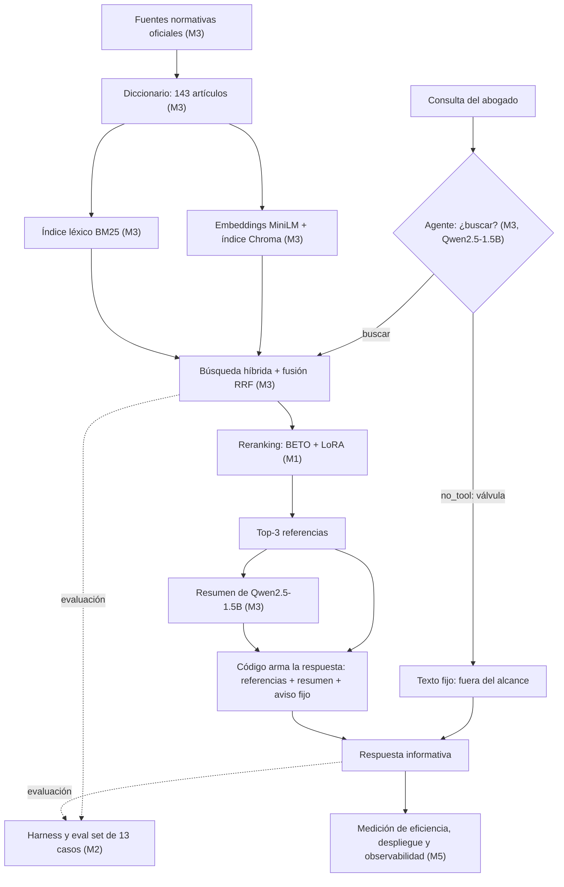

# Reporte final · Asistente de consulta de derecho laboral individual

Equipo Lawten · SI4006 · Proyecto integrador (Módulos 1 a 5)

> Las secciones marcadas con **[PENDIENTE]** dependen del despliegue o de la información del equipo y se completan al
> terminar esas partes. Todas las cifras salen de los CSV versionados en `notebooks/` y `final/eficiencia/resultados/`.

## 1. El problema y el usuario

**Usuario.** Un abogado junior colombiano (de cero a tres años de experiencia) que redacta una demanda, una contestación,
un concepto o una cláusula.

**Decisión que toma con el sistema.** Qué norma y qué artículo citar o revisar para la situación que tiene delante. El
sistema informa y verifica; nunca recomienda acciones sobre el caso. El juicio jurídico es del abogado.

**Cómo lo hace hoy.** De memoria, con búsquedas manuales lentas o con asistentes conversacionales genéricos que pueden
inventar citas.

**Métrica de éxito que importa para la decisión.** No es la calidad del texto que escribe el modelo: es que **la norma
correcta esté entre las tres referencias que el abogado ve** (recall@3 de la norma esperada), porque una norma que no
aparece es una norma que el abogado no revisa. La segunda métrica es **saber cuándo no hay respuesta**: ante una consulta
fuera del dominio o con una premisa falsa, el sistema debe decirlo y no presentar tres artículos como si resolvieran el
caso.

## 2. El sistema en un diagrama

El módulo 4 (componente visual) no se implementó; ver la sección 8. Las piezas viven en `final/sistema.py`, que carga el
pipeline completo una sola vez y expone `responder`, un método de salud y la latencia de cada componente.

## 3. Decisiones técnicas y alternativas descartadas

| Decisión | Elegido | Alternativa descartada y por qué |
|---|---|---|
| Modelo base del reranker (M1) | BETO (`bert-base-spanish-wwm-cased`) con LoRA, cross-encoder | mBERT y DistilBERT: tokenizan peor el texto jurídico en español (1.56 contra 1.35 tokens por palabra) y DistilBERT no sigue el patrón LoRA estándar. Detalle en `notebooks/decisiones_base_encoder.ipynb` |
| Unidad de recuperación | El artículo completo (143 unidades) | Partirlo en fragmentos: obligaría a reagrupar para citar. No se probó un chunking más fino; queda como mejora |
| Recuperación | Búsqueda híbrida (denso + BM25, fusión RRF) y reranking con el cross-encoder de M1 | Solo búsqueda densa: 1/13 aciertos. Multi-query con términos jurídicos: no mejora a C2 y suma 1.2 s |
| Modelo de embeddings | `paraphrase-multilingual-MiniLM-L12-v2`, el de los laboratorios | No se comparó con otros; su límite de 128 tokens recorta 97 de los 143 artículos |
| Decoder | Qwen2.5-1.5B-Instruct, que solo escribe un resumen | No se comparó con otros decoders. Se le quitó la tarea de decidir qué norma aplica porque no la hace de forma fiable (precisión cercana al azar en la prueba exploratoria) |
| Patrón visual | Ninguno | Ver sección 8 |
| Técnica de eficiencia | Cuantizar el decoder (que también decide el agente) | Destilar o afinar con LoRA un modelo más pequeño: exigen entrenar y evaluar otro modelo, y no había tiempo. Cuantizar no requiere entrenamiento. Resultado en la sección 9 |

## 4. Tabla evolutiva

Mismo eval set de 13 casos, mismo harness, mismo juez (Claude Haiku, rúbrica 2.0.0) y misma máquina (GPU T4 de Colab)
en todas las filas.

| Sistema | Aciertos | Recall@3 medio | Juez medio | Casos con imagen | Latencia mediana |
|---|---|---|---|---|---|
| Línea base del Módulo 2 (cross-encoder sobre todo el corpus) | 2/13 | 0.23 | 2.04 | no aplica | 9.6 s |
| Sistema del Módulo 3 (agente + híbrida + reranking) | 2/13 | 0.18 | 2.35 | no aplica | 8.8 s |
| Sistema del Módulo 4 | no se hizo | | | | |
| Sistema final (M3 sin cuantizar, desplegado) | 3/13 | 0.18 | 2.42 | no aplica | 9.6 s (p95 12.3 s) |

Notas.
- El sistema final es el de M3 sin cambios de modelo, porque la técnica de eficiencia no sirvió en GPU. La fila se midió en
  la sesión de eficiencia (`final/eficiencia/resultados/gpu/`). El 3/13 contra el 2/13 de M3 no es una mejora: en M2-11 el juez dio
  exactamente 4.0, que es el umbral de acierto, y ese caso cambia con el ruido del juez (cerca de 0.1 entre corridas).
- Otras referencias de M3, medidas igual: RAG ingenuo 1/13, recall 0.09, juez 1.77, 5.3 s. RAG avanzado (C2) 2/13, recall
  0.18, juez 2.23, 6.6 s.
- La versión en CPU, solo como respaldo si el despliegue tiene que serlo: 177 s de mediana con la línea base y 145 s con
  `gguf_q8_0` (sección 9).

## 5. Ablaciones

Cada una quita una pieza y mide con el mismo harness. Fuentes: `notebooks/rag/resultados/avanzado/`,
`notebooks/rag/resultados/final/` y `final/eficiencia/resultados/`.

| Pieza que se quita | Con la pieza | Sin la pieza | Lectura |
|---|---|---|---|
| Reranking con el cross-encoder | C2: 2/13, recall 0.18, juez 2.23, 6.6 s | B (híbrida sola): 4/13, recall 0.27, juez 2.08, 5.7 s | Quitar el reranking **mejora** los aciertos: BM25 recupera normas que el reranking descarta, y la fusión actual conserva las del cross-encoder y pierde las de BM25 |
| Búsqueda híbrida (BM25) | C2 (híbrida + reranking): 2/13, recall 0.18 | C1 (densa + reranking): 3/13, recall 0.23 | Diferencia de un caso: no concluyente |
| Herramienta (agente) | Agente + C2: 2/13, recall 0.18, juez 2.35, 8.8 s | C2 sola en la misma sesión: 2/13, recall 0.18, juez 2.35, 6.2 s | El agente no mejora nada y cuesta 2.7 s; en los tres casos donde la decisión importaba decidió mal |
| Técnica de eficiencia | Cuantizado (GPU): 1/13; (CPU, 4 bits): 1/13 | Sin cuantizar: 3/13 (GPU), 2/13 (CPU) | La cuantización no mejora el sistema; ver la sección 9 |

Con 13 casos, una diferencia de uno o dos aciertos es ruido. La ventaja de B depende de que la regla de acierto exija
las dos normas en M2-06 y M2-09: con una regla menos estricta, B, C1, C2 y D empatan en 4/13.

## 6. Análisis de errores

Sistema final en la T4 (`final/eficiencia/resultados/gpu/M3_transformers_detalle.csv`). Falla en 10 de 13 casos. Agrupados por tipo:

| Tipo | Casos | Qué pasó | Pieza que falló | Qué haríamos |
|---|---|---|---|---|
| **A. La norma esperada no llega al top-3 por confusión entre normas cercanas** | M2-03, M2-05 | Se espera Ley 361 de 1997 Art. 26 (protección frente al despido de quien está en situación de discapacidad); llegan Ley 776 de 2002 y Ley 1010 de 2006 (accidente laboral, acoso) | Reranking (cross-encoder de M1) y primer filtro denso | Reentrenar el cross-encoder con negativos difíciles obtenidos con BM25; chunks más cortos para que el embedding no se quede en los primeros 128 tokens |
| **B. Relato largo y norma general** | M2-04, M2-08, M2-10 | Salarios impagos, aportes y despidos descritos con muchos hechos; la norma esperada es abstracta (CST Art. 57, Constitución Art. 53, CST Art. 62) y llegan artículos de la Constitución o de leyes sectoriales | Recuperación: la similitud entre un relato y una norma abstracta es baja | Extraer primero los hechos jurídicos de la consulta (con el decoder) y buscar con ellos; probar la híbrida con multi-query sin reranking |
| **C. Recuperación parcial** | M2-06, M2-09 | Llega una de las dos normas esperadas (recall 0.5) y la regla de acierto exige las dos | Recuperación y regla de acierto | Subir k o ampliar la recuperación para casos con varias normas; reportar también el acierto parcial |
| **D. Mismo contenido bajo otra cita** | M2-01 | Llega la Ley 1822 de 2017 Art. 2, que reproduce el CST Art. 239; cuenta como fallo, aunque el juez le da 4 | Regla de evaluación (cita exacta) | Mapear normas equivalentes en el diccionario antes de calificar |
| **E. El agente decide no buscar en un caso laboral** | M2-02, M2-07 | El agente elige `no_tool` y la respuesta es el texto fijo «fuera del alcance del corpus», que es engañoso en un caso laboral | Agente (válvula) | Quitar el agente (no aporta nada medible) o buscar siempre y abstenerse según la distancia de los resultados, no según un modelo de 1.5B |

Un tipo más, de abstención frágil. M2-11 (premisa falsa: «artículo 850 del CST») y M2-12 (choque de carro) cuentan como
aciertos, pero el sistema devuelve tres artículos irrelevantes y la abstención depende del resumen de Qwen. M2-11 acierta
con un juez de 4.0, justo en el umbral, y en la corrida de CPU falló. La pieza que decide es el decoder, no una válvula
del sistema.

## 7. Limitaciones: dónde no hay que creerle al sistema

- **No es fiable para elegir la norma.** El mejor sistema trae la norma esperada en pocos casos (recall@3 de 0.18 en el
  final y de 0.27 en la mejor variante de la ablación). El abogado debe verificar siempre las citas.
- **No se abstiene de forma fiable.** Salvo cuando el agente decide no buscar (y en el eval set lo hizo en los casos
  equivocados), el sistema devuelve siempre tres referencias, también en consultas fuera del dominio o con premisas falsas.
  Que el resumen lo reconozca depende de Qwen2.5-1.5B.
- **El corpus es pequeño:** 143 artículos de 41 normas. Una norma que no está en el diccionario nunca se recupera.
- **Evaluación pequeña:** 13 casos, 11 con norma esperada. Los casos semilla salen del dataset de M1 y no se excluyeron
  de su entrenamiento, lo que podría favorecer al cross-encoder.
- **Juez externo y no determinista** (Claude Haiku): su puntaje varía cerca de 0.1 entre corridas.
- **Latencia en CPU:** unos dos minutos por consulta; el sistema necesita GPU para una demo en vivo.
- **Cuando no sabe,** el sistema muestra el aviso fijo «informativo, no es recomendación jurídica personalizada», y la
  decisión final es siempre del abogado.

## 8. Por qué no hay componente visual

El Módulo 4 era opcional y **no lo implementamos**. El plan inicial (`docs/STAI_Plantilla_Proyecto.md`, sección 6) era que el
abogado subiera la imagen de un documento y un modelo de visión y lenguaje detectara qué normas cita y verificara que las
citas son correctas. No lo hicimos por tres razones:

1. **No ataca la falla principal.** El sistema falla en recuperar la norma a partir de un relato de hechos: en 10 de 13
   casos la norma esperada no llega. Agregar una imagen como entrada no mejora esa recuperación.
2. **Sería incompleto sin su propia evaluación.** Una verificación de citas sobre documentos escaneados necesita un OCR como
   línea base, un modelo de visión y lenguaje, un eval set de imágenes con su comparación y la prueba de invarianza. Con el
   tiempo disponible, preferimos medir bien lo que existe, como pide la asignación: un sistema modesto con una evaluación
   honesta vale más que uno ambicioso que nadie midió.
3. **Era opcional.** Asumimos la consecuencia: la columna «casos con imagen» de la tabla evolutiva no aplica, no hay prueba
   de invarianza del Módulo 4 y el sistema no recibe imágenes.

Si se retomara, habría que partir de un OCR como línea base y de un eval set de 10 a 15 documentos con las citas marcadas.

## 9. Técnica de eficiencia (resumen)

Detalle y tablas completas en `final/eficiencia/eficiencia.md`.

- **Qué:** cuantizar Qwen2.5-1.5B, que decide el agente y escribe el resumen y es casi toda la latencia en la T4 (9.3 de
  9.6 s).
- **Umbral antes de medir:** perder hasta 1 acierto de 13, sin bajar el recall ni los adversariales, si la mediana baja de 5 s.
- **GPU (T4), bitsandbytes:** no sirvió. int8 es tres veces más lento (29.1 s contra 9.6 s) y nf4 no acelera (9.8 s) y rompe
  el JSON del agente en 11 de 20 consultas. Ambos pierden los casos de abstención (M2-11 y M2-12).
- **CPU (2 hilos), GGUF:** int8 (`q8_0`) mantiene toda la calidad con el decoder 3.3 veces más pequeño y la mediana un 18 %
  menor (177 s a 145 s); int4 pierde la mitad del recall y deja la válvula peor (5 consultas laborales sin buscar contra 2).
- **Veredicto:** el umbral **no se cumplió** con ninguna versión; la línea base de M3 en la T4 ya estaba en 9.6 s, por
  encima de los 5 s.
- **Decisión:** en GPU se despliega M3 sin cuantizar. Si el despliegue tuviera que ser en CPU, `gguf_q8_0` es la versión
  eficiente.
- **Pruebas repetidas sobre la versión eficiente:** válvula (20 consultas) y casos adversariales. La prueba de invarianza
  del Módulo 4 no aplica porque no hay componente visual.

## 10. Despliegue y observabilidad **[PENDIENTE]**

A completar cuando esté desplegado:
- URL de la demo y enlace al proyecto de W&B (también en la portada del README).
- Cómo se llama el health check.
- Ejemplo de una línea del log JSON (hora, latencia, componentes usados, si se activó la válvula; sin datos personales).
- Qué quedó afuera del hardware gratuito, si algo.
- Enlace o captura del video demo de respaldo.

## 11. Ética

1. **¿A quién podría fallarle más?** A los trabajadores cuyo caso no encaja en las 41 normas del corpus: por ejemplo,
   quienes tienen contrato de prestación de servicios o un vínculo del sector público, o una situación que la
   jurisprudencia resuelve y el diccionario no recoge. También a quien describe su caso en un relato largo y coloquial,
   como son las consultas del eval set, donde el sistema falla en 10 de 13. Lo medimos solo en esos 13 casos y no por
   grupos de usuarios; lo demás es sospecha.
2. **¿Qué pasa con los datos?** El abogado escribe en texto libre y podría incluir nombres, cédulas o empresas de su
   cliente. El sistema no pide datos personales ni los necesita. El log por petición guarda solo hora, latencia,
   componentes usados y si se activó la válvula, no el texto de la consulta. **[PENDIENTE: confirmar con el despliegue lo
   que guarda el log y si W&B recibe el texto]**. Las consultas del eval set son relatos reales del dataset de M1, sin datos
   de contacto.
3. **¿Qué daño haría un error?** El peor error es que el abogado confíe en una norma equivocada o, peor, que el sistema
   le diga que su consulta laboral está «fuera del alcance» (lo hizo en M2-02 y M2-07) y el caso pierda tiempo útil, por
   ejemplo un plazo de prescripción. Lo sufre el cliente del abogado. Lo que pusimos: el aviso fijo en cada respuesta, el
   sistema solo informa y no recomienda acciones, y la decisión es siempre del abogado. Como la válvula del agente no es
   fiable, la mitigación real es humana.

## 12. Quién hizo qué **[PENDIENTE: completar con el equipo]**

- Pablo Cabrejos: sistema final integrado (`final/sistema.py`), medición de la técnica de eficiencia (`final/`), reporte.
- Miguel Ángel Ortiz: **[por completar]**
- Martín Valencia: **[por completar]**
- Samuel López: **[por completar]**

## 13. Uso de IA

Todo el equipo usó asistentes de IA (Claude de Anthropic, ChatGPT de OpenAI, entre otros) para construir el proyecto. Buena
parte del código parte de los notebooks y laboratorios del curso (el harness de las sesiones 5 y 6, el RAG de las
sesiones 7 y 8, la plantilla de fine-tuning y el laboratorio de despliegue de la sesión 15), que se tomaron como base. Esa
base se editó y adaptó a las necesidades del proyecto con el apoyo de los asistentes, que actuaron como programadores:
escribieron y modificaron código (el sistema final, la app y los notebooks de medición), ayudaron a analizar resultados y
a redactar la documentación y el reporte. Las decisiones de cada etapa (qué construir, qué probar, cómo evaluar, qué
umbral aceptar y qué descartar, incluido el componente visual) las tomó el equipo, que dirigió el proyecto, revisó los
resultados y aprobó los cambios. Los resultados reportados provienen de ejecuciones reales en Google Colab y las cifras de
este reporte se copian de los archivos CSV generados.

Además, dos modelos forman parte del sistema y no son herramientas de redacción: Qwen2.5-1.5B-Instruct como decoder que
resume y Claude Haiku como juez en la evaluación.
